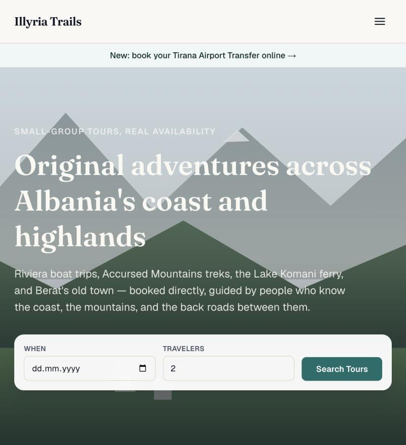

# Illyria Trails

A booking platform for small-group tours across Albania — Riviera boat trips, Accursed Mountains treks, the Lake Komani ferry, Berat's old town, and airport transfers.

**Live:** [illyria-trails.vercel.app](https://illyria-trails.vercel.app)



## About

Illyria Trails is a full tour-operator website: browsing and searching tours, checking live availability, booking and paying online, and managing an existing booking — backed by a Sanity-powered content layer so tours, categories, and travel guides can be edited without a deploy.

## Features

- **Tour catalog** — categories, sub-categories, "things to do", attractions, and inspiration/guide content, all editable through Sanity
- **Search & availability** — a date/traveler-count search widget backed by an availability API
- **Booking flow** — cart, checkout, and payment, plus a "my booking" lookup page for returning customers
- **SEO** — structured data (JSON-LD) for organization and local-business schema, per-page metadata
- **Multi-currency support** via a currency context provider
- **Support & content pages** — FAQ/support requests, careers, policies (privacy, cookies, environmental, equal pay), tour status, and meeting points
- **Form handling** with `react-hook-form` + `zod` validation throughout (search, checkout, support requests)
- Tested with Vitest + React Testing Library

## Tech stack

| Layer | Technology |
|---|---|
| Framework | [Next.js 16](https://nextjs.org) (App Router) |
| Language | TypeScript |
| Styling | Tailwind CSS 4 |
| CMS | [Sanity](https://www.sanity.io) (`next-sanity`) |
| Animation | Framer Motion |
| Forms/validation | React Hook Form + Zod |
| Testing | Vitest, React Testing Library |
| Deployment | Vercel |

## Getting started

```bash
npm install
npm run dev
```

Open [http://localhost:3000](http://localhost:3000) to view it locally. The site reads tour/category/guide content from a Sanity project — set the relevant `NEXT_PUBLIC_SANITY_*` environment variables locally to connect your own dataset, or rely on the project's built-in fallback data for a quick preview without Sanity configured.

```bash
npm run build   # production build
npm run lint    # lint the project
npm run test    # run the test suite (Vitest)
```

## Project structure

```
src/
├─ app/            # Routes: tours, attractions, checkout, cart, support, policy pages, APIs
├─ components/     # UI components (cards, forms, layout)
├─ data/           # Content-fetching helpers (tours, categories, guides, site settings)
├─ sanity/         # Sanity client/schema configuration
├─ lib/            # Shared utilities (schema.org helpers, etc.)
└─ types/          # Shared TypeScript types
```

## Location

Built for the Albanian tourism market — Tirana, Albania.
